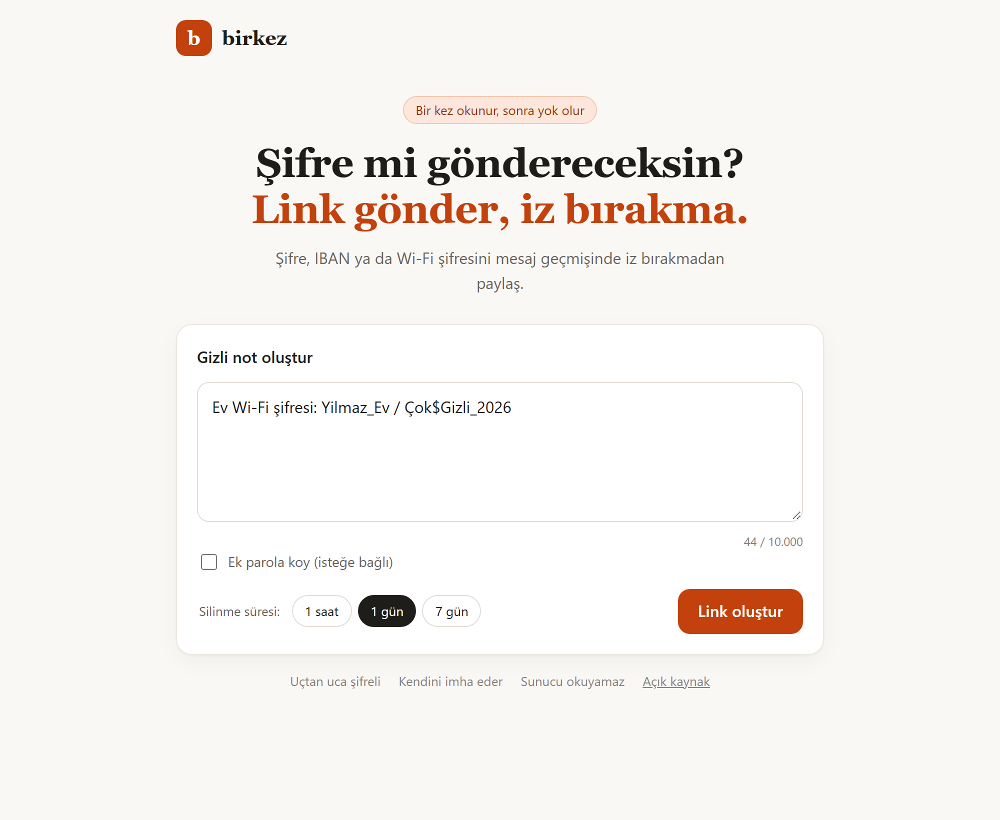
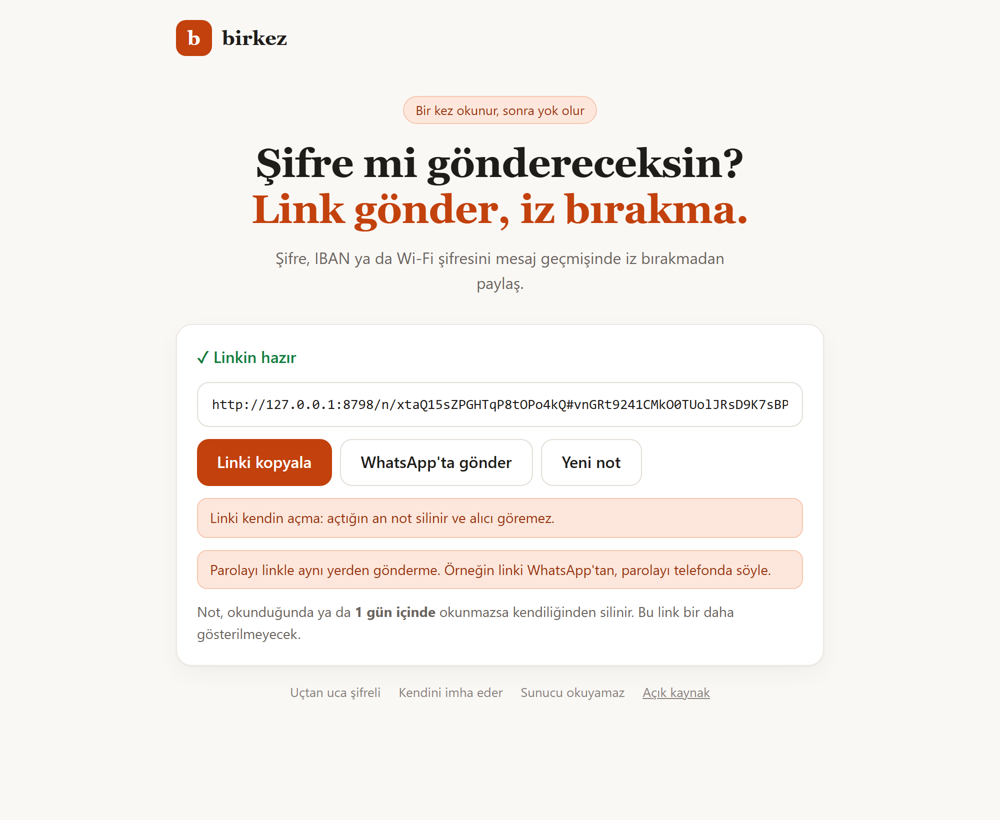
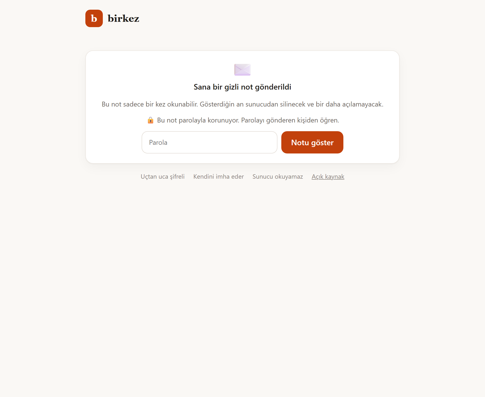
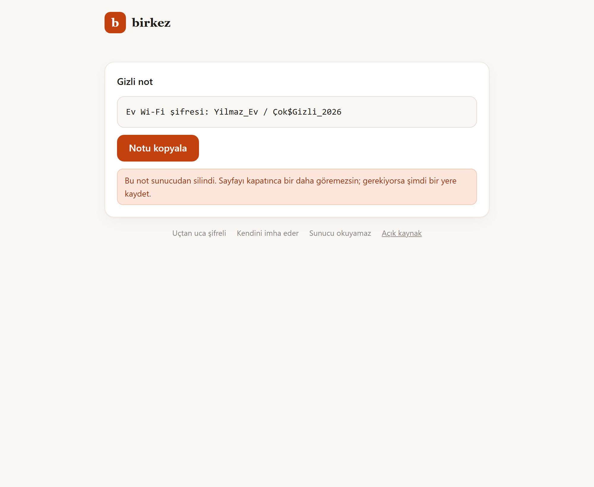
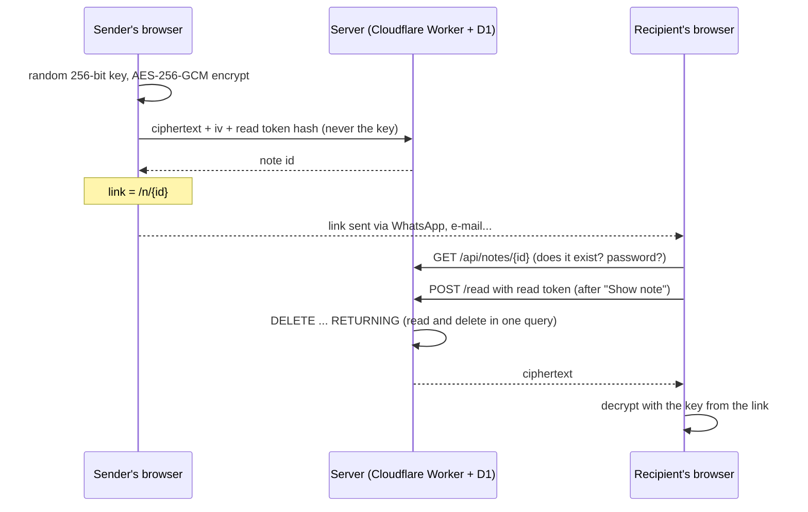

# birkez

[](https://github.com/yusufiyilmaz/birkez/actions/workflows/tests.yml)
[](LICENSE)

**English** | [Türkçe](README.tr.md)

Self-destructing notes that can be read only once. Share passwords, IBANs or Wi-Fi keys without leaving them in your chat history. Notes are encrypted in the browser, so the server never sees what you wrote. *("birkez" means "once" in Turkish.)*

<p align="center">
  
  
</p>
<p align="center">
  
  
</p>

## How it works



1. You write a note. Your browser generates a random key and encrypts the note **on your device** (AES-256-GCM).
2. Only the encrypted note reaches the server. You get a link like `https://birkez.example.workers.dev/n/Xk3p9Qa2…#key`.
3. When the recipient clicks "Show note", the encrypted note is fetched from the server and **deleted in the same operation**. The browser decrypts it with the key from the link.

## Security model

- **The server cannot read notes.** The key lives in the part of the link after `#`, which browsers never send to the server. A stolen database contains only ciphertext.
- **Read-once guarantee.** A note is deleted in the same query that reads it (`DELETE ... RETURNING`); even if several people open the link at the same moment, only one of them sees it.
- **Safe from link-preview bots.** When WhatsApp or Telegram fetches the link to build a preview, the note is not burned; it is fetched only after the "Show note" button is pressed, with a `POST` request.
- **Optional extra password.** The real key is the link key XOR a PBKDF2-SHA256 (600,000 rounds) hash of the password, so a leaked link alone cannot open the note. The password never leaves the browser.
- **Wrong passwords don't burn the note.** The browser proves it holds the right key with a read token derived from it; the server stores only the token's SHA-256 and hands the note out only for a matching token. After 5 wrong attempts the note is deleted. Someone who knows only the note id (without the `#` key) cannot burn it either.
- **Note length is hidden.** Notes are padded to fixed sizes (256 B, 1 KB, 4 KB, 16 KB, 40 KB) before encryption, so "yes" and a long IBAN look the same to the server.
- **Rate limiting.** Each IP can create 10 notes and make 30 read attempts per minute, which stops scripted spam and token guessing.
- **Expiry.** Unread notes are deleted when the chosen time (1 hour / 1 day / 7 days) runs out; an hourly job cleans them up.
- **Hardened pages.** Strict Content Security Policy (only the site's own scripts, no inline code), `Referrer-Policy: no-referrer`, no third-party scripts or fonts. The key is removed from the address bar and browser history as soon as the read page loads.

## Known limitations

Being honest about what this design can't protect against:

- **You have to trust the code the server sends.** Like every browser-based end-to-end encryption tool, if the server itself were compromised, an attacker could serve modified JavaScript that leaks keys. The code is open source so it can be audited, but the browser can't verify it on its own.
- **Whoever has the full link can read the note.** If the link (and password, if any) leaks before the recipient opens it, someone else can read it first. The recipient will then see "this note no longer exists", which at least reveals that it was read.
- **Metadata is visible to the server:** IP addresses, timing, and the size bucket of the note.
- **The recipient can still copy the note.** Read-once means it's deleted from the server, not that the recipient can't take a screenshot.

## Tech stack

- **Browser:** plain HTML/CSS/JS, Web Crypto API (AES-256-GCM, PBKDF2, SHA-256), no build step, no third-party code
- **Server:** Cloudflare Workers + D1 (SQLite), Workers Rate Limiting, hourly cron for expired notes
- **Tests:** Node's built-in test runner. Unit and server tests run against a real local D1 database; browser tests drive headless Chrome/Edge via the DevTools Protocol with no extra dependencies. Both run on every push in GitHub Actions.

## Project structure

```
public/            static pages served to the browser
  crypto.js        encryption, padding, password and read token (shared with tests)
  app.js           write page
  read.js          read page
  _headers         security headers (CSP etc.)
src/
  worker.js        API: create, check, read-and-delete; rate limiting; cleanup cron
  limits.js        constants
migrations/        D1 database schema
test/              unit + server tests       (npm test)
e2e/               browser tests, screenshots (npm run test:e2e, npm run screenshots)
```

## Run locally

Requires Node.js 22+.

```bash
npm install
npm run db:local     # create the local database tables (once)
npm run dev          # http://localhost:8791
npm test             # unit + server tests
npm run test:e2e     # browser tests (needs Chrome or Edge)
```

## Roadmap

- [x] Encryption / decryption in the browser
- [x] Server (Cloudflare Workers + D1 database)
- [x] Read page with the "Show note" step
- [x] Expiry and optional extra password
- [x] Length padding and rate limiting
- [x] Unit, server and browser tests in CI
- [ ] Deploy (Cloudflare workers.dev)
- [ ] Read receipt and cancel link for the sender

## Security

Found a vulnerability? Please see [SECURITY.md](SECURITY.md).

## License

[MIT](LICENSE)
