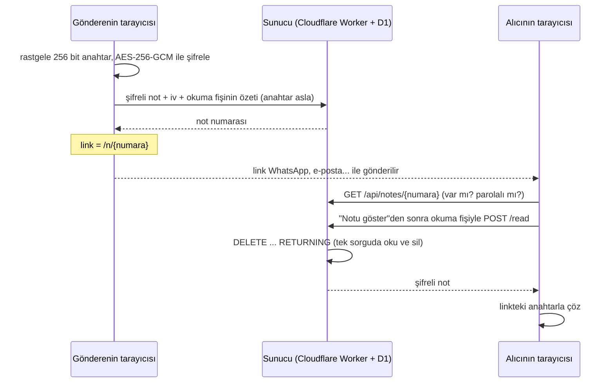

# birkez

[](https://github.com/yusufiyilmaz/birkez/actions/workflows/tests.yml)
[](LICENSE)

[English](README.md) | **Türkçe**

Bir kez okunduktan sonra kendini imha eden notlar. Şifre, IBAN ya da Wi-Fi şifresi gibi bilgileri mesaj geçmişinde iz bırakmadan paylaşmak için. Notlar tarayıcıda şifrelenir; sunucu ne yazdığını hiçbir zaman göremez.

<p align="center">
  
  
</p>
<p align="center">
  
  
</p>

## Nasıl çalışır



1. Notu yazarsın. Tarayıcın rastgele bir anahtar üretir ve notu **senin cihazında** şifreler (AES-256-GCM).
2. Sunucuya sadece şifreli hali gider. Sana `https://birkez.example.workers.dev/n/Xk3p9Qa2…#anahtar` gibi bir link verilir.
3. Linki açan kişi "Notu göster"e basınca şifreli not sunucudan alınır ve **aynı anda silinir**. Tarayıcı, linkteki anahtarla notu çözer.

## Güvenlik modeli

- **Sunucu notu okuyamaz.** Anahtar linkin `#` işaretinden sonraki kısmındadır; tarayıcılar bu kısmı sunucuya hiç göndermez. Veritabanı çalınsa bile elde edilen sadece anlamsız şifreli veridir.
- **Tek okuma garantisi.** Not, okunduğu sorguda silinir (`DELETE ... RETURNING`); birkaç kişi aynı anda açmaya çalışsa bile sadece biri görür.
- **Link önizleme botlarına karşı korumalı.** WhatsApp ya da Telegram linki önizlemek için açtığında not yanmaz; not ancak "Notu göster" butonuna basılınca `POST` isteğiyle alınır.
- **İsteğe bağlı ek parola.** Asıl anahtar, link anahtarı ile parolanın PBKDF2-SHA256 (600.000 tur) özetinin XOR'udur; link tek başına başkasının eline geçse bile notu açamaz. Parola tarayıcıdan hiç çıkmaz.
- **Yanlış parola notu yakmaz.** Tarayıcı, doğru anahtara sahip olduğunu anahtardan türetilen bir okuma fişiyle kanıtlar; sunucu fişin sadece SHA-256 özetini saklar ve notu yalnızca tutan fişe verir. 5 yanlış denemeden sonra not silinir. Linkin sadece numarasını bilen biri (`#` anahtarı olmadan) da notu yakamaz.
- **Not uzunluğu gizlenir.** Notlar şifrelenmeden önce sabit boylara (256 B, 1 KB, 4 KB, 16 KB, 40 KB) doldurulur; "evet" ile uzun bir IBAN sunucuya aynı boyda görünür.
- **Hız sınırı.** Her IP dakikada en fazla 10 not oluşturabilir ve 30 okuma denemesi yapabilir; script ile spam ve fiş tahmini engellenir.
- **Süre sınırı.** Okunmayan notlar seçilen süre (1 saat / 1 gün / 7 gün) dolunca silinir; saatlik bir görev temizlik yapar.
- **Sıkılaştırılmış sayfalar.** Sıkı Content Security Policy (sadece sitenin kendi scriptleri, satır içi kod yok), `Referrer-Policy: no-referrer`, üçüncü taraf script ya da yazı tipi yok. Okuma sayfası açılır açılmaz anahtar adres çubuğundan ve tarayıcı geçmişinden silinir.

## Bilinen sınırlar

Bu tasarımın neye karşı koruyamadığını dürüstçe yazmak gerekirse:

- **Sunucunun gönderdiği koda güvenmek zorundasın.** Tarayıcıda şifreleme yapan her araçta olduğu gibi, sunucunun kendisi ele geçirilirse saldırgan anahtarları sızdıran değiştirilmiş bir JavaScript sunabilir. Kod açık kaynak olduğu için incelenebilir ama tarayıcı bunu kendi başına doğrulayamaz.
- **Linkin tamamına sahip olan notu okuyabilir.** Link (ve varsa parola) alıcı açmadan önce sızarsa başkası önce okuyabilir. Bu durumda alıcı "Bu not artık yok" görür; en azından notun okunduğu ortaya çıkar.
- **Üst veri sunucuya görünür:** IP adresleri, zamanlar ve notun boy kovası.
- **Alıcı notu yine de kopyalayabilir.** Tek okuma, notun sunucudan silinmesi demektir; alıcının ekran görüntüsü almasını engellemez.

## Kullanılan teknolojiler

- **Tarayıcı:** Sade HTML/CSS/JS, Web Crypto API (AES-256-GCM, PBKDF2, SHA-256); derleme adımı ve üçüncü taraf kod yok
- **Sunucu:** Cloudflare Workers + D1 (SQLite), Workers Rate Limiting, süresi dolan notlar için saatlik zamanlanmış görev
- **Testler:** Node'un yerleşik test aracı. Birim ve sunucu testleri gerçek bir yerel D1 veritabanında çalışır; tarayıcı testleri başsız Chrome/Edge'i DevTools Protocol ile, ek paket olmadan yönetir. Hepsi her push'ta GitHub Actions'ta çalışır.

## Proje yapısı

```
public/            tarayıcıya giden sayfalar
  crypto.js        şifreleme, doldurma, parola ve okuma fişi (testlerle ortak)
  app.js           not yazma sayfası
  read.js          okuma sayfası
  _headers         güvenlik başlıkları (CSP vb.)
src/
  worker.js        API: oluştur, kontrol et, oku ve sil; hız sınırı; temizlik görevi
  limits.js        sabitler
migrations/        D1 veritabanı şeması
test/              birim + sunucu testleri          (npm test)
e2e/               tarayıcı testleri, ekran görüntüleri (npm run test:e2e, npm run screenshots)
```

## Kendi bilgisayarında çalıştırma

Node.js 22 veya üstü gerekir.

```bash
npm install
npm run db:local     # yerel veritabanı tablolarını oluştur (bir kez)
npm run dev          # http://localhost:8791
npm test             # birim + sunucu testleri
npm run test:e2e     # tarayıcı testleri (Chrome ya da Edge gerekir)
```

## Yol haritası

- [x] Tarayıcıda şifreleme / çözme
- [x] Sunucu (Cloudflare Workers + D1 veritabanı)
- [x] Okuma sayfası ve "Notu göster" adımı
- [x] Süre sınırı ve isteğe bağlı ek parola
- [x] Uzunluk gizleme ve hız sınırı
- [x] CI'da birim, sunucu ve tarayıcı testleri
- [ ] Yayın (Cloudflare workers.dev)
- [ ] Gönderen için okundu bilgisi ve iptal linki

## Güvenlik

Bir güvenlik açığı mı buldun? [SECURITY.md](SECURITY.md) dosyasına bak.

## Lisans

[MIT](LICENSE)
